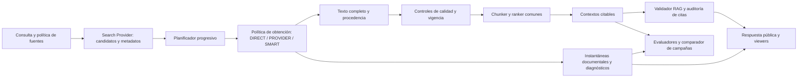

# Informe de implementación del motor de obtención de evidencias

**Fecha:** 28 de octubre de 2026.
**Ámbito:** cambios locales de Evidence Search, adaptadores de búsqueda, cadena de citas, viewers y evaluación desarrollados en este hilo.
**Estado:** implementación y pruebas locales completadas; activación de SMART y validación integral en despliegue pendientes.

## Resumen ejecutivo

Evidence Search dispone ahora de un motor de obtención configurable que toma las URL descubiertas por un proveedor de búsqueda y puede conseguir el texto del documento por tres vías: texto completo incluido en la búsqueda, HTTP directo y extracción de una URL mediante el proveedor. La decisión se expresa mediante las políticas `DIRECT`, `PROVIDER` y `SMART`. El ConfigMap conserva `DIRECT` como política activa y tiene desactivada la extracción adicional por proveedor.

Todas las vías que producen un documento utilizable confluyen en el **mismo chunker, ranker y constructor de contextos citables**. La procedencia acompaña a la evidencia hasta el validador, la auditoría de citas, los viewers y los evaluadores. El cambio es un motor genérico: no introduce decisiones especiales por aserción, dominio o sitio; las particularidades de Exa y Tavily quedan en sus adaptadores.

El resultado funcional más importante es poder recuperar una evidencia cuando la descarga directa falla, por ejemplo ante un 403, sin ocultar ese fallo ni presentar una copia de vigencia desconocida como una lectura actual. La mejora real de cobertura, calidad, latencia y coste frente a `DIRECT` aún requiere dos campañas E2E comparables sobre el servicio desplegado.

## Alcance funcional extremo a extremo

| Etapa | Capacidad implementada | Efecto funcional |
| --- | --- | --- |
| Descubrimiento | Exa y Tavily normalizan resultados y conservan `raw_content` separado de `content`, snippets y highlights. | Un resumen de búsqueda sirve para seleccionar candidatos, pero no se cita como si fuera el documento completo. |
| Planificación | Primera tanda configurable, por defecto de dos candidatos; reserva de resultados ya recibidos; reposición y escalada de búsqueda cuando faltan fuentes citables. | Se evita procesar todos los resultados cuando el objetivo ya está cubierto y se intenta recuperar cobertura antes de dar la búsqueda por fallida. |
| Obtención | Política genérica con texto de Search, descarga HTTP, copia documental opcional y extracción por URL del proveedor. | Se puede elegir el compromiso entre control directo, disponibilidad y dependencia del proveedor. |
| Validación del documento | URL HTTP pública para extracción externa, longitud mínima, detección de páginas de bloqueo y política de vigencia. | Una respuesta HTTP 200 o un texto cualquiera no bastan para producir una fuente citable. |
| Contextualización | Texto admitido por cualquier vía entra al mismo particionado, ranking y selección de ventanas. | Los validadores reciben el mismo contrato de contextos con independencia del método de obtención. |
| Citas y handoff | Contextos con ID, hash, elegibilidad y origen; hash del bundle v2 con procedencia; auditoría sobre el corpus canónico. | Una cita publicada puede vincularse al contexto realmente entregado y a la procedencia declarada. |
| Presentación y evaluación | Viewers muestran método y vigencia; métricas y ledger separan búsqueda, HTTP, extracción y caché. | Se puede inspeccionar por qué una fuente fue usable y medir el coste y el efecto de cada ruta. |

### Semántica de las políticas

| Política | Orden de obtención para una URL | Uso previsto |
| --- | --- | --- |
| `DIRECT` | Copia documental si se activa su reutilización; en otro caso, descarga HTTP propia. | Comportamiento activo: lectura directa de la URL, con diagnóstico y reintentos del descargador existente. |
| `PROVIDER` | Texto completo incluido en Search; si se permite extracción externa, copia documental reutilizable y después extracción por URL. No abre un nuevo HTTP propio a la fuente. | Entornos donde se prefiere delegar la obtención al proveedor, aceptando sus límites de cobertura, coste y vigencia. |
| `SMART` | Texto completo de Search válido; después copia documental opcional; después HTTP propio; si falla, extracción externa opcional. | Política híbrida que usa material ya obtenido, mantiene una ruta directa y recupera fallos con un servicio externo. |

`PROVIDER` y `SMART` solo aceptan `raw_content` como texto completo de Search. Si está ausente, es demasiado corto, parece una página de bloqueo o se exige vigencia conocida, se rechaza. El texto de Search no aporta aquí una fecha de rastreo verificable: recibe `freshness_status=UNKNOWN`. La fecha en que nuestro servicio lo recibe no se usa como fecha de captura de la fuente.

La descarga directa aceptada se marca `OBSERVED_NOW`. La extracción por URL solo recibe esa marca cuando el adaptador comunica una lectura en vivo. Si se exige vigencia conocida, Exa solicita `maxAgeHours=0` y exige `source=live` para la URL concreta; Tavily declara que esa garantía no está soportada en su extracción y la política estricta no acepta la respuesta. Estas reglas expresan lo que valida el código, no una prueba independiente de autenticidad del contenido remoto.

### Por qué se diseñó así

Buscar y descargar son operaciones distintas. El buscador encuentra URL relevantes, pero su snippet puede omitir datos decisivos. Descargar directamente permite aplicar nuestros límites, inspeccionar errores y saber que hicimos una lectura en ese momento; también puede fallar por 403, CAPTCHA, límites de tráfico, formatos difíciles o problemas de red. Delegar la descarga puede rescatar esas URL y aprovechar texto que el proveedor ya obtuvo, a cambio de coste adicional, posible antigüedad desconocida y dependencia de su API.

La política híbrida mantiene esas diferencias visibles. Un 403 directo seguido de extracción válida produce una evidencia utilizable, **pero el 403 sigue registrado** como fallo de HTTP directo. La fuente citable queda identificada como `provider_extract`; el historial negativo de URL sigue describiendo únicamente el acceso HTTP propio. Así, la recuperación no falsea las métricas ni borra la causa original. La elección operativa entre `DIRECT` y `SMART` se reserva para datos de campañas comparables.

## Planificación, presupuestos y recuperación

El planificador diversifica los resultados y procesa inicialmente hasta `EVIDENCE_INITIAL_BATCH_SIZE` candidatos, respetando el objetivo de fuentes citables. Si no llega a ese objetivo, consume primero candidatos de reserva de la misma respuesta del proveedor. Cada URL se procesa como candidato una vez; sustituir una URL fallida por otra no es un reintento de la primera. Después puede ejecutar rondas de búsqueda adicionales y, para Exa, pasar del perfil Lite al Auto según la utilidad de los resultados. Las restricciones de fuentes de la estrategia activa siguen aplicándose en la reposición.

La extracción externa por URL es una capacidad opcional de `SearchProvider.extract`, con resultado tipado y un presupuesto compartido entre tanda inicial, reserva y escaladas. El valor configurado es `EVIDENCE_MAX_PROVIDER_EXTRACT_CALLS=2` por petición. Antes de enviar una URL al proveedor se valida que sea HTTP pública mediante el validador del descargador. Se comprueba el resultado **de esa URL** dentro de la respuesta: en Exa, `results` y `statuses`; en Tavily, `results` y `failed_results`. Un HTTP 200 del endpoint de extracción no equivale a documento adquirido.

La decisión citable requiere texto admitido por la política y al menos un contexto producido por el ranking. Si falla la obtención o no hay contextos adecuados, la URL y su diagnóstico pueden quedar en la respuesta, con `citation_status=unavailable`; no se inventa un contexto. `citation_eligible=true` significa que el contexto pasó estos controles de recuperación. La compatibilidad semántica de la cita con la aserción sigue siendo responsabilidad de la auditoría y del validador.

## Persistencia, vigencia y trazabilidad

Cada evidencia incorpora `document_provenance`: método, proveedor cuando aplica, URL solicitada y resuelta, fecha de recepción, fecha de captura conocida cuando existe, estado de vigencia, SHA-256 del texto, identificador de petición del proveedor y referencia a instantánea. `acquisition_attempts` conserva la secuencia de decisiones y los intentos de extracción, con duración, resultado y coste/uso cuando el proveedor lo comunica. La traza de llamadas de Search permanece separada. `retrieval_summary` ofrece contadores de documentos por método, solicitudes HTTP, extracciones externas, texto rechazado, vigencia desconocida y fallos directos recuperados.

El almacén `evidence_document_snapshots_v1` guarda instantáneas de texto por URL normalizada, método, proveedor y hash de contenido. Una versión nueva del texto obtiene otra identidad. La retención configurada es de siete días; se omite el texto superior a 8 MiB y en ese caso `snapshot_id` queda vacío. La escritura o lectura fallida de Mongo no detiene la obtención normal. Al leer una instantánea se verifica su identidad y hash antes de reutilizarla.

La reutilización está **desactivada por defecto** (`EVIDENCE_DOCUMENT_REUSE_MAX_AGE_SECONDS=0`). Con una edad máxima positiva, el motor puede leer una copia antes de hacer HTTP o extracción por URL; la etiqueta es `document_cache` y la vigencia `CACHED_KNOWN_AGE`. Se conserva la fecha de la lectura original. La política estricta solo permite reutilizar una copia originalmente observada en vivo y dentro del plazo fijado. La caché de respuestas por aserción sigue siendo distinta de este almacén documental; la política de extracción participa en su clave y las respuestas negativas tienen TTL según su carácter transitorio o permanente.

Hay un límite puntual en la secuencia actual: en `PROVIDER`, si el texto de Search no sirve y `allow_provider_extract=false`, se devuelve fallo antes de consultar una instantánea aunque la reutilización documental estuviera activada. No afecta a la configuración actual, donde reutilización y extracción externa están desactivadas, pero conviene eliminar ese retorno anticipado antes de combinar `PROVIDER` con reutilización sin extracción externa.

El bundle de evidencias v1 sigue disponible para artefactos históricos. El nuevo `evidence_bundle_hash_v2` incluye el texto canónico de los contextos y la procedencia declarada, incluidos hash del documento, ID de instantánea e identificadores de proveedor. El validador conserva ambos hashes en el handoff y el replay/evaluador comprueba v2 cuando está presente. `evidence_used` se construye a partir de los contextos canónicos recuperados, no de enlaces inventados por el modelo, y transmite su procedencia. Este encadenamiento detecta alteraciones del material entregado o de su declaración de origen; **no demuestra por sí solo que el sitio original publicó ese texto**. La auditoría posterior del documento íntegro depende de que exista una instantánea retenida.

## Viewers, evaluación y coste

El viewer web presenta el método de obtención y la vigencia en las evidencias: texto extraído por proveedor, lectura directa o copia documental, con estados desconocido, observado ahora y copia de antigüedad conocida. El viewer diagnóstico conserva la procedencia junto a los contextos y el estado de citas. Los contratos son aditivos, de modo que artefactos anteriores sin estos campos siguen siendo legibles.

El evaluador de Retrieval expone documentos por método, fuentes citables, cobertura de referencia, intentos HTTP, extracciones por proveedor, fallos recuperados y vigencia desconocida. Las métricas existentes de citas, ranking, veredicto y latencia siguen disponibles. El ledger de costes registra un evento por llamada real de extracción y separa ese componente de Search. Una respuesta servida desde caché no vuelve a cargar llamadas históricas. El importe `costDollars.total` de Exa se etiqueta como estimación del proveedor; los créditos de Tavily se convierten a USD solo si la campaña declara una tarifa por crédito, o se utiliza una tarifa explícita por llamada. Cuando falta precio o una llamada falla sin información de facturación, el coste se mantiene desconocido; no se convierte silenciosamente en cero.

`evaluation.pipeline.compare_modes` compara dos campañas guardadas `DIRECT` y `SMART`. Empareja dataset, caso, texto de aserción, ID y versión de validador, estrategia y número de repeticiones. Marca `INCOMPLETE` si difieren los grupos, hay hits de caché de respuesta, tarifas distintas o modos no declarados. Para campañas comparables calcula diferencias de fuentes citables, cobertura, corrección de veredicto, citas, latencia, llamadas HTTP/Search/Extract, coste informado, vigencia y recuperaciones, e incluye los totales del viewer. El comparador está probado con datos sintéticos; **todavía no existe una comparación real DIRECT frente a SMART** en los artefactos de este hilo.

## Configuración activa y límites operativos

| Configuración del ConfigMap | Valor | Consecuencia actual |
| --- | --- | --- |
| `EVIDENCE_FETCH_FULL_TEXT` | `true` | Se intenta obtener texto y construir contextos citables. |
| `EVIDENCE_EXTRACTION_MODE` | `DIRECT` | La ruta híbrida está implementada, pero no se usa en el despliegue configurado. |
| `EVIDENCE_ALLOW_PROVIDER_EXTRACT` | `false` | No se hacen llamadas adicionales de extracción por URL. |
| `EVIDENCE_MAX_PROVIDER_EXTRACT_CALLS` | `2` | Límite preparado para cuando se habilite esa capacidad. |
| `EVIDENCE_REQUIRE_KNOWN_FRESHNESS` | `false` | La política puede admitir copias de vigencia desconocida al activar `SMART` o `PROVIDER`. |
| `EVIDENCE_DOCUMENT_REUSE_MAX_AGE_SECONDS` | `0` | Se guardan instantáneas, pero no se reutilizan para nuevas peticiones. |
| `EVIDENCE_DOCUMENT_SNAPSHOT_TTL_SECONDS` | `604800` | Retención de siete días del texto almacenado. |
| `EVIDENCE_INITIAL_BATCH_SIZE` | `2` | La planificación progresiva sí modifica la tanda inicial también en `DIRECT`. |

Los perfiles de proveedor y la cantidad de resultados siguen configurables. Añadir otro proveedor requiere un adaptador que normalice los resultados y, si ofrece extracción por URL, implemente la capacidad opcional `extract`; el motor no necesita reglas de negocio para ese proveedor.

## Escenarios funcionales verificables

| Situación | Resultado previsto |
| --- | --- |
| Search devuelve documento íntegro válido en `SMART` | Se usa `provider_search_text`, se etiqueta vigencia desconocida y se pasa al pipeline común sin HTTP directo. |
| Search devuelve solo snippet o highlight | Se descarta como documento; se intenta la siguiente vía permitida. |
| La fuente bloquea el HTTP propio y el extractor externo obtiene texto válido | Se conserva el fallo directo, se cita la copia `provider_extract` y se contabiliza una recuperación. |
| El endpoint externo responde 200, pero la URL concreta falla | La extracción queda fallida; no se crea contexto citable. |
| Se exige vigencia conocida y Search aporta copia sin fecha verificable | Se rechaza la copia; se prueba una ruta capaz de acreditar lectura actual. |
| Hay una instantánea reutilizable dentro de la edad configurada | Se usa `document_cache` con fecha original y hash verificado; no se factura otra extracción. |
| Ninguna ruta entrega texto o el ranking no crea contextos | La fuente sigue siendo diagnosticable, pero no citable. |

## Verificación realizada y alcance de sus conclusiones

- En la última tanda local registrada en la [bitácora de implementación](evidence-retrieval-engine-plan.md) pasaron **165 pruebas Python** de las áreas afectadas; **18 quedaron excluidas**. Diecisiete corresponden a divergencias preexistentes entre dobles de prueba y el descargador/validador de URL; una a una expectativa previa de costes que cuenta dos validadores aunque el fixture contiene tres. Las exclusiones no equivalen a pruebas superadas.
- Pasaron **20 pruebas del viewer web**. También pasaron la comprobación de sintaxis de los dos módulos JS editados, la compilación Python de los módulos nuevos y `git diff --check`. Estas comprobaciones avalan contratos y escenarios locales; no miden calidad real de evidencias en producción.
- El intento E2E guardado en [el informe de campaña](../../tests/data/evaluation/artifacts/e2e-20261028-201350/report.md) terminó con 33 fallos técnicos en `AUTHENTICATION`, todos antes de Retrieval. La causa observada fue `Operation not permitted` al abrir sockets desde el sandbox, no un rechazo 401/403 de credenciales. En pruebas localizadas fuera de ese límite, OIDC y los servicios respondieron, el proveedor de tokens obtuvo un token y una llamada autenticada llegó a la aplicación. El túnel local 7443 necesario para ese recorrido ya se cerró. Ese E2E **no valida el motor nuevo** y los servicios desplegados deben incorporar primero el código local para poder medirlo.

## Pendiente para cerrar el alcance funcional en despliegue

1. Desplegar el código y ejecutar una campaña E2E completa con el port-forward de OIDC activo y acceso a la red local. Confirmar que cada ejecución llega a Retrieval y que los viewers muestran procedencia y vigencia.
2. Ejecutar campañas frías `DIRECT` y `SMART` con el mismo corpus, validador, estrategia y tarifas. Habilitar extracción externa en la campaña SMART y usar el comparador; revisar fuentes citables, referencias, veredictos, citas, latencia, coste y frescura antes de cambiar el valor activo del ConfigMap.
3. Ajustar la retención de instantáneas a la vida útil deseada de los artefactos de evaluación. Para documentos superiores a 8 MiB, definir si basta el hash sin texto íntegro archivado.
4. Comprobar en una ejecución real el contrato de vigencia de la extracción Exa (`statuses.source`) y mantener la política estricta cerrada ante valores no reconocidos.

## Mapa de la implementación

| Módulo | Responsabilidad principal |
| --- | --- |
| [`api/evidence-search/app/acquisition.py`](../../api/evidence-search/app/acquisition.py) | Política, orden de rutas, controles de texto y vigencia, diagnósticos por intento. |
| [`api/evidence-search/app/document_store.py`](../../api/evidence-search/app/document_store.py) | Identidad, persistencia y reutilización verificada de instantáneas. |
| [`api/evidence-search/main.py`](../../api/evidence-search/main.py) | Planificación, presupuestos, integración con contextos, respuesta, cachés y resumen de Retrieval. |
| [`api/common/search/`](../../api/common/search/) | Contrato opcional de extracción y adaptadores Exa/Tavily. |
| [`api/common/utils/evidence_bundle.py`](../../api/common/utils/evidence_bundle.py) y [`api/common/utils/evidence.py`](../../api/common/utils/evidence.py) | Hashes de handoff y citas construidas desde contextos recuperados. |
| [`api/validate-asertions/main.py`](../../api/validate-asertions/main.py) | Entrega del corpus al validador y auditoría de las citas declaradas. |
| [`web_classic/app/js/app.js`](../../web_classic/app/js/app.js) | Presentación de método y vigencia en el viewer web. |
| [`tests/evaluation/pipeline/metrics.py`](../../tests/evaluation/pipeline/metrics.py), [`tests/evaluation/viewer/costs.py`](../../tests/evaluation/viewer/costs.py) y [`tests/evaluation/pipeline/compare_modes.py`](../../tests/evaluation/pipeline/compare_modes.py) | Métricas, costes y comparación de campañas. |
| [`k8s/apis/evidence-search/base/configmap.yaml`](../../k8s/apis/evidence-search/base/configmap.yaml) | Valores preparados para desplegar y activar las políticas. |

La [documentación de la API](apis/evidence-search.md) describe el contrato de Evidence Search; la [bitácora](evidence-retrieval-engine-plan.md) conserva las subfases, pruebas y puntos de reanudación.
