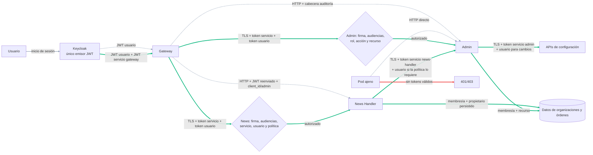

# S03 — Identidad y autorización entre servicios

**Decisión de arquitectura:** Keycloak es el único emisor de tokens. Gateway autentica al usuario y obtiene su propio token de servicio, pero no firma JWT ni credenciales delegadas. Cada API destinataria verifica ambos tokens de Keycloak cuando la operación representa a una persona y decide el permiso sobre el recurso.

**Estado:** implementación local activa en kind y pruebas técnicas superadas; aceptación E2E autenticada y preproducción pendientes. **Ámbito:** SEC-03 y la parte sensible de SEC-16. S02 está validado localmente; su aceptación de preproducción se agrupará con fases posteriores.

## Problema y frontera

Gateway comprueba JWT y rol del usuario, pero varios servicios confían después en parámetros o cabeceras que un llamante interno puede construir. News Handler acepta `admin=True` por defecto en `/orders/{id}`, `/news`, eventos y consistencia; también recibe `client_id` en la URL de publicación y consulta. Admin expone gestión de clientes/cuotas y configuración LLM sin autenticar localmente al llamante; la auditoría de cambios LLM toma `x-assermetry-admin-user`. Gateway deriva el propietario histórico de `sub`, pero esa clave no representa por sí sola una organización. Las rutas de configuración de Generate Assertions, Validate Assertions y Source Router, así como la búsqueda que consume proveedores, amplían la superficie interna.

El diseño cubre las llamadas HTTP internas del perfil `apis-frontend` y la obtención de claves de identidad. Kafka queda para S07; las cuotas atómicas para S05; estado y revocación de organizaciones para S06. S03 debe proporcionar ya identidad verificable, atribución y aislamiento para sus rutas HTTP. S04 añadirá segmentación de red, sin sustituir autorización. S10 consolidará y endurecerá la verificación JWT/JWKS general; S03 no puede diferir la comprobación criptográfica necesaria para autenticar servicios.

## Contrato del motor

Crear un paquete compartido `api/common/security/` con cuatro interfaces reutilizables:

1. `authenticate_service(request, audience) -> ServicePrincipal`: verifica firma, emisor, algoritmo permitido, `aud`, `exp`, `nbf` si existe, `iat`, `azp`/cliente presentador y sujeto no vacío. El principal se obtiene de un token de servicio emitido con *client credentials* para la audiencia del destinatario; la tabla de emisores, clientes y audiencias permitidos es configuración validada. Nunca se infiere el llamante de una cabecera de nombre, IP o Service DNS.
2. `authenticate_user(request, audience) -> UserPrincipal | None`: verifica de forma independiente el **access token** de usuario emitido por Keycloak, recibido en una cabecera interna separada de `Authorization` (por ejemplo, `X-Assermetry-User-Token`). Exige firma, emisor, algoritmo, `aud` del destinatario, `exp`, `nbf` si existe, `iat`, `azp` permitido y `sub`. El contrato distingue rutas con usuario obligatorio de llamadas autónomas de servicio; nunca acepta `org_id`, usuario o rol desde query, body ni cabeceras sueltas. Solo se reenvía el token por rutas declaradas que lo necesitan, tras eliminar cualquier copia aportada desde fuera de Gateway.
3. `authorize(service_principal, user_principal, action, resource) -> Decision`: decisión por defecto **denegar**, con reglas versionadas de servicio llamante, audiencia, acción, tipo de recurso, necesidad de usuario y rol humano. La ruta FastAPI declara una acción estable; el motor resuelve membresía del usuario y propietario del recurso desde almacenamiento confiable y los compara. La cobertura de rutas se verifica al iniciar: una ruta sin regla pública explícita o acción asignada impide arrancar. Los fallos de autenticación devuelven 401; los de autorización, 403; la indisponibilidad de claves o resolución de propietario falla cerrada.
4. `service_client.call(target, action, resource, user_token?)`: adquiere y renueva tokens de servicio para una audiencia concreta. Solo propaga el token de usuario a destinos y acciones declarados, y elimina cabeceras de identidad aportadas por el cliente externo. Usa TLS con CA y nombre de servidor verificados, plazo acotado y diagnósticos sin tokens. No hay modo de retroceso a HTTP para operaciones protegidas.

La matriz de políticas es **datos**, no ramas de código por cliente, noticia, URL o modelo. Una regla tiene `caller`, `audience`, `action`, `resource_type`, `user_required`, `roles` y `scope` (`own`, `any` o recurso de sistema). Validación de esquema, referencias y duplicados al arrancar. Las excepciones para `/health` y `/ready` son explícitas y no devuelven datos sensibles. Documentación/OpenAPI interna requiere política o queda deshabilitada en el perfil seguro.

## Flujos propuestos

| Llamada | Principal y acción | Decisión de recurso |
| --- | --- | --- |
| Gateway → News Handler: publicar, leer/listar órdenes, eventos, consistencia e importación | Token de servicio `gateway` + token del usuario, ambos de Keycloak; `orders:create`, `orders:read`, `events:read`, `news:import` | Resolver organización desde membresía del usuario; filtrar lecturas por `org_id` y propietario persistido. `view_all` requiere concesión explícita `orders:read:any` a un usuario administrador. |
| Gateway → Admin: configuración LLM y clientes | Token de servicio `gateway` + token del operador, ambos de Keycloak | Admin verifica directamente acción y recurso; `updated_by` sale del sujeto verificado. Ninguna cabecera de auditoría decide identidad. |
| News Handler → Admin: consulta/consumo de cuotas | Token de servicio `news-handler`; `quotas:read`/`quotas:write`. En una publicación iniciada por usuario, propaga también su token solo si la política exige identidad humana. | Para una orden existente, Admin resuelve su organización desde la orden. En la publicación, comprueba membresía y organización del usuario. El servicio no obtiene permiso global solo por poseer un token. |
| Admin → Generate/Validate/Source Router: configuración de ejecución | Token de servicio `admin` + token de usuario para `runtime:write`; `runtime:read` según política | Recurso de configuración concreto; sin capacidad de reenvío arbitrario a otras rutas. |
| Validadores → Source Router/Evidence Search; Gateway → Generate/IPFS | Principal de servicio y acción de lectura/generación acotada; token de usuario cuando la acción sobre un recurso suyo lo requiera | El destinatario comprueba audiencia, acción y, si hay datos de una orden, propietario obtenido de la orden. Probes quedan separados. |

La identidad humana viaja como access token de Keycloak **solo por los saltos declarados** que necesitan actuar en su nombre. Gateway lo comprueba primero; cada destinatario vuelve a comprobarlo y además exige un token de servicio propio del llamante. Configurar en Keycloak las audiencias de usuario necesarias mediante client scopes/mappers; no usar un token con audiencia universal. El servicio de destino consulta una membresía `issuer + subject -> org_id + roles` del lado servidor. Si un usuario pertenece a varias organizaciones, la selección de organización es solo una solicitud que el destinatario contrasta con esa membresía. Un administrador global necesita una acción `*:any` explícita y auditada; el rol `trust-admin` por sí solo no convierte cada lectura en global. Las validaciones de caché que hoy se limitan al propietario conservan ese alcance hasta que exista una regla específica.

### Un mismo mapa: hoy y S03

Las flechas **grises discontinuas** muestran los pasos actuales relevantes; las **verdes continuas**, los nuevos controles y comunicaciones. La flecha roja indica el rechazo que debe observarse desde un pod sin identidad autorizada. Keycloak permanece como único emisor; Gateway y las demás APIs solo verifican tokens y aplican política.



La autorización sucede en **News Handler/Admin y en cada API destinataria**, no solo en Gateway. El token de servicio acredita al llamante; el de usuario acredita a la persona. La política exige ambos cuando corresponde y comprueba el propietario en datos persistidos. Una llamada autónoma lleva solo identidad de servicio y únicamente puede ejecutar acciones expresamente previstas para ese servicio.

### Opciones valoradas

| Opción | Emisores | Ventaja | Coste y decisión |
| --- | --- | --- | --- |
| **Dos tokens de Keycloak por llamada humana** | Solo Keycloak | Compatible con Keycloak 24; cada destino comprueba persona y servicio sin aceptar una cabecera de identidad como autoridad. | El token humano llega a varios servicios autorizados y es reutilizable hasta su expiración. **Elegida para S03** con audiencias concretas, TLS y política por acción/recurso. |
| Gateway firma una delegación corta | Keycloak + Gateway | Delegación por destino, acción y recurso, con posible control de un solo uso. | Gateway pasa a ser otro emisor y custodio de claves de firma; cada servicio debe confiar en sus tokens y mantener estado contra replay. Descartada para preservar un único emisor. |
| Keycloak intercambia token para cada destino | Solo Keycloak | Token humano más acotado para el siguiente salto. | En Keycloak 24 exige habilitar una función preliminar. Se reevaluará tras actualizar Keycloak; no es dependencia de S03. |

## Propietarios históricos y migración

El `client_id` actual mezcla propietario y cuota, y suele derivarse de `sub`. Introducir `org_id` estable y una colección de membresías con índice único por `issuer + subject + org_id`; mantener una tabla versionada `legacy_client_id -> org_id` para órdenes y cuotas previas. El migrador produce inventario, ambigüedades y un plan reversible; solo incorpora asociaciones verificadas, sin inferir una organización desde un parámetro del usuario. Orden sin asociación inequívoca queda invisible para consultas ordinarias hasta resolverla. Durante transición, las consultas usan `org_id` o un `legacy_client_id` asociado de forma explícita a la organización verificada; la escritura nueva guarda `org_id` y conserva la clave antigua únicamente donde la compatibilidad la necesita. No se reescriben IDs de órdenes ni se mezclan cuotas de organizaciones distintas.

El estado activo/suspendido, vigencia y baja de membresías o clientes se conectarán en S06. S03 valida la asociación y la autorización actual de cada petición; no presenta esa comprobación como revocación inmediata de trabajos Kafka ya iniciados.

## Credenciales, transporte y replay

- Crear una identidad de cliente por servicio con credenciales fuera de Git, audiencia específica y permisos mínimos. Verificar en kind que el emisor entregue los claims exigidos antes de activar la política. Los tokens se obtienen por el canal autenticado de identidad, se guardan solo en memoria y se renuevan antes de expirar. El verificador aplica límites de tamaño/algoritmo y una fuente de claves autenticada; el motor de caché, rotación y concurrencia de JWKS se completará en S10.
- Proteger con TLS verificado todos los tramos que portan tokens, incluido Keycloak/JWKS y las llamadas HTTP entre APIs. Certificados y claves privadas se montan como Secrets, nunca en ConfigMaps ni en el repositorio. Definir CA interna, SAN de Service DNS, rotación con solape y fallo cerrado si la identidad TLS no coincide. El servicio verifica además los tokens: TLS de servidor no concede acciones por sí mismo. No se introduce un *service mesh* como requisito.
- Mantener corta la vigencia de access tokens, limitar audiencias y clientes autorizados, evitar su propagación innecesaria y no registrarlos. Los JWT de usuario son reutilizables durante su vigencia: **S03 no promete rechazo de replay por `jti`**. En cambios administrativos, usar identificador de operación y control de versión/compare-and-set donde sea necesario; la idempotencia completa de publicación/consumo corresponde a S05. Nunca registrar el token, el secreto o una cabecera de autorización.
- En la versión desplegada de este repositorio, Keycloak 24, el [intercambio de tokens está en *Technology Preview* y desactivado por defecto](https://www.keycloak.org/docs/24.0.5/securing_apps/). Por eso S03 no depende de token exchange. Keycloak 24 permite [configurar audiencias mediante mappers/client scopes](https://www.keycloak.org/docs/24.0.5/server_admin/index.html). Un futuro intercambio por tokens de usuario más acotados requerirá evaluar una actualización de Keycloak y sus permisos, no activar una función preliminar como requisito implícito.
- Los errores de autenticación/autorización se registran con `request_id`, actor de servicio, acción, tipo de recurso y código de decisión, sin texto de la noticia ni datos personales completos. Deben poder correlacionarse Gateway y destinatario.

## Secuencia de implementación local

1. Inventariar rutas HTTP y llamadas del perfil local; construir matriz de permisos versionada y comprobar cobertura completa de rutas. Preparar identidades, audiencias y certificados de kind sin credenciales embebidas.
2. Configurar client scopes/audiencias de Keycloak para cada servicio y para el access token humano solo donde se propague. Implementar/verificar el motor común de los dos principales, política y cliente TLS. Añadir pruebas con claves efímeras de firma, expiración, audiencia, `azp`, token de servicio ausente, usuario ausente donde sea obligatorio y fallo de CA/nombre.
3. Implantar primero en Admin y News Handler con modo de observación local limitado en tiempo para detectar llamadas legítimas; después activar denegación obligatoria. Eliminar `admin=True`, `client_id` y `x-assermetry-admin-user` como fuentes de autoridad. Gateway elimina cabeceras de identidad entrantes, obtiene su token de servicio y propaga el access token humano solo según política. Extender al resto de APIs internas según matriz.
4. Migrar asociaciones de propietarios con informe de ambigüedad y consultas de compatibilidad acotadas. Probar dos organizaciones, órdenes antiguas y nuevas, rol insuficiente, acceso directo desde pod ajeno, identidad/cabecera alterada, expiración, token de usuario con audiencia incorrecta, rutas sin política y repetición de operaciones mutantes con identificador de operación.
5. Repetir LIGHT/SMART y las rutas administrativas en kind; recoger SHA, imagen, política, certificados públicos, resultados 401/403 y latencias. Preparar despliegue conjunto posterior en preproducción con rollback de configuración/credenciales, sin ejecutarlo al cerrar este diseño.

**Puerta de aceptación local:** ninguna ruta sensible acepta una llamada directa sin principal válido; las rutas humanas requieren **ambos** tokens válidos; un token de un servicio o audiencia no sirve para otro; una organización no lee ni altera recursos de otra; Admin atribuye cambios al usuario verificado; las rutas legítimas LIGHT/SMART y la administración autorizada siguen funcionando. **Estado: superada en kind**; la aceptación de preproducción permanece pendiente.

## Implementación y evidencia local, 08-11-2026

El motor común de políticas y tokens está en `api/common/security/engine.py`; Admin y News Handler comprueban también pertenencia y propietario. Keycloak sigue siendo el único emisor. `reconcile_s03_keycloak.py` crea identidades y audiencias; con `--local-overlays` guarda un `s03-client.env` por identidad dentro del overlay local de su API, con permisos `0600` y excluido por `*.env` en Git. Los `secretGenerator` de cada Kustomization convierten esos archivos en Secrets durante Skaffold y sus patches persistentes montan cada Secret en el Deployment correspondiente. Para preproducción el reconciliador conserva `--output-dir`, que exige un directorio privado externo al repositorio y nunca imprime secretos; el operador aplica esos archivos manualmente como Kubernetes Secrets. `s03_local_pki.py` crea los Secrets TLS fuera de Git y `activate_s03_kind.py` configura TLS y políticas en el contexto `kind-*`. El Gateway usa overlays locales persistentes para el Service TLS y el backend HTTPS de Traefik. No se ha integrado la activación S03 como overlay de preproducción.

En kind se activaron Keycloak y nueve Deployments API con TLS en puerto 9443; todos los rollouts quedaron listos. Traefik llega a Gateway por HTTPS con CA interna y nombre verificado. Smoke real: Ingress `/backend/capabilities` 200; News Handler con token de servicio 200 y sin token 401; Admin sin token de usuario 401; Evidence Search y Validator sin token 401; llamador o audiencia incorrectos 401. La suite focalizada terminó con 72 pruebas correctas; `compileall` y `git diff --check` limpios. La migración local asoció cuatro identidades verificadas y dejó dos claves históricas sin asociación, invisibles por defecto, hasta su revisión.

El operador confirmó E2E autenticados correctos en modos DIRECT y SMART. En una comprobación posterior, los Deployments S03 activos estaban Ready y `check_s03_configured_secrets.sh` pasó sin mostrar valores. El inventario de propietarios de solo lectura en MongoDB/Keycloak informó 4 usuarios mapeados con 4 aliases, 2 claves legacy sin mapear, 1 clave presente en órdenes y 2 en cuotas; no se aplicó cambio alguno. `tests/api/test_s03_security.py` pasó (5 pruebas), incluida una denegación de propietario ajeno simulada en memoria. Con autorización del operador se preparó `regression-alpha-user` para login de prueba usando la contraseña local indicada y eliminando la acción obligatoria `UPDATE_PASSWORD`.

Con esa sesión, antes de crear datos el listado devolvió 200 y la cuenta no tenía órdenes propias (`org_id` ni legacy). El E2E LIGHT `synthetic-light-01` creó la orden `def3eefc-bb4b-478c-b071-fa1179665925`, que alcanzó `VALIDATED`. MongoDB confirmó que su `org_id` corresponde al sujeto autenticado; el listado del usuario incluye la orden y el detalle devuelve 200 con el mismo ID y estado. La cuota de generación pasó de 3 a 4 consumos, quedando 96 de 100 disponibles. La lectura de una orden de otra organización fue denegada con 403. La única orden histórica sin propietario mapeado también devolvió 403 y permanece oculta; no se reasignó. Una actualización administrativa no-op de `generate-asertions` devolvió 200, su `updated_by` coincide con el sujeto verificado del token y avanzó la versión; se mantuvieron los valores de proveedor, modelo y temperatura enviados, aunque la auditoría/versionado sí cambió.

La aceptación local de S03 queda cerrada con lectura propia de una orden nueva y denegación del registro histórico sin dueño verificable. La ejecución E2E guardó su informe en `/tmp/s03-regression-alpha-order-20261108-retry/report.json`. La activación y aceptación de preproducción, más la revisión manual futura del dueño de la orden legacy, quedan pendientes y no bloquean el cierre local. La CA y los certificados locales están en `/tmp/s03-kind-pki`; las credenciales se guardan en los overlays locales ignorados de cada API.

Para reactivar el perfil local tras Skaffold, con esos materiales conservados, ejecutar en este orden:

```bash
python3 scripts/security/s03_local_pki.py --output-dir /tmp/s03-kind-pki --apply-kind
python3 scripts/security/activate_s03_kind.py --apply-kind --phase infra
kubectl rollout status deployment/keycloak -n infra
python3 scripts/security/activate_s03_kind.py --apply-kind --phase apis
python3 scripts/security/activate_s03_kind.py --apply-kind --phase edge
```

## Qué ganamos y qué cuesta

**Ganamos** autorización efectiva en el servicio que posee los datos, aislamiento entre organizaciones, auditoría atribuible y una política común revisable. Un pod con conectividad a `ClusterIP` deja de poder ejercer permisos por escribir `admin=true` o una cabecera. La segmentación de S04 tendrá entonces una segunda barrera independiente.

**Costes y pérdidas:** hay más credenciales, certificados, configuración de audiencias y rotación; cada llamada añade validación y, en renovación, una petición al emisor. Propagar el token de usuario a destinatarios concretos amplía los lugares donde existe durante su vigencia; no tiene la limitación por petición que daría una delegación firmada o un token intercambiado. Las consultas de membresía y propietario aumentan latencia y pueden impedir acceso si la asociación histórica es ambigua. El fallo cerrado puede cortar flujos existentes hasta completar la matriz. El doble soporte temporal de `client_id`/`org_id` exige una migración cuidadosa. Kafka continúa sin este control hasta S07 y la revocación de trabajos ya en curso se cierra en S06/S07.
